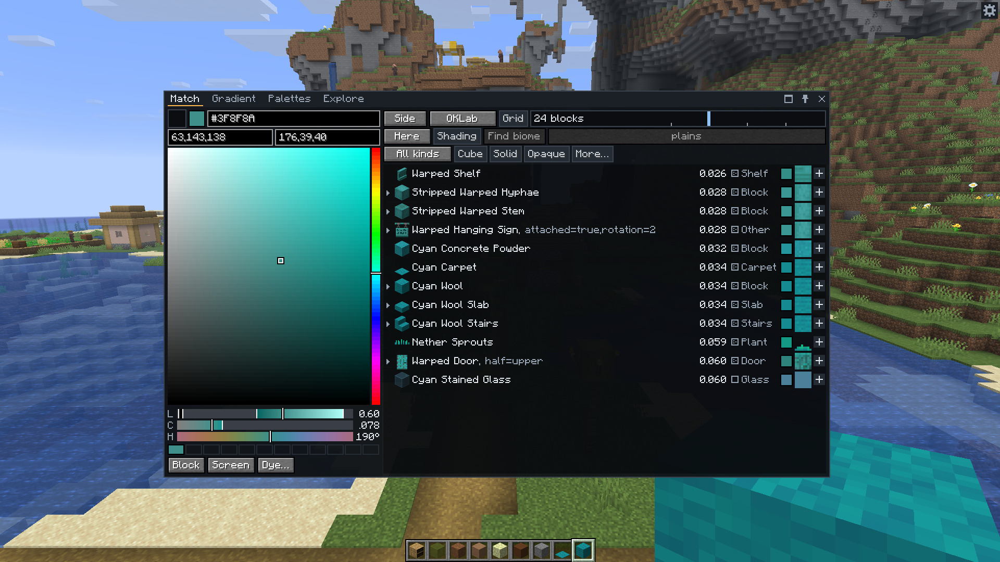

<div align="center">
<h1>Chroma Studio</h1>


<a href="https://modrinth.com/mod/chroma-studio"></a>
<a href="https://www.curseforge.com/minecraft/mc-mods/chroma-studio"></a>
</div>

A client-only Fabric and NeoForge mod for Minecraft Java 1.21.11. It finds the blocks closest to a colour, builds palettes and gradients from them, and exports them as schematics. The [wiki](https://github.com/Neil-001/chroma-studio/wiki) covers matching, palettes, gradients, exports and settings.

Building requires JDK 25.

```
./gradlew build                 # builds both jars and runs the tests
./gradlew :fabric:runClient     # starts a Fabric dev client with the mod
./gradlew :neoforge:runClient   # starts a NeoForge dev client with the mod
```

On Windows, use `gradlew.bat`. The jars end up in `fabric/build/libs/` and `neoforge/build/libs/`. The Minecraft, Fabric and NeoForge versions are in `gradle.properties`.

- The shared code is in `src/`. `fabric/` and `neoforge/` each hold only that loader's entrypoints and metadata.
- `dev.chromastudio.core` holds the colour maths, palettes, gradients and schematic layouts. It has no Minecraft imports, so its tests run without the game. Keep it that way.
- `dev.chromastudio.api` is the API for other mods, and the only package that follows semantic versioning.
- Run `./gradlew build` before pushing.

---

License: MIT.
